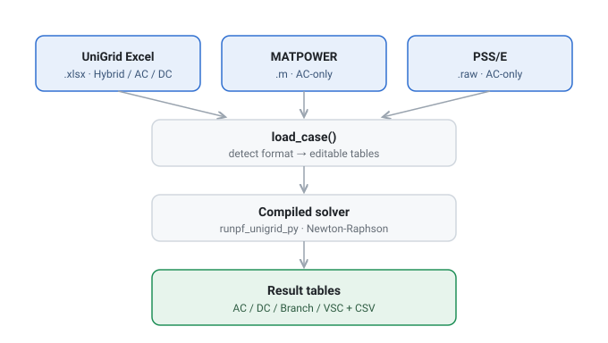
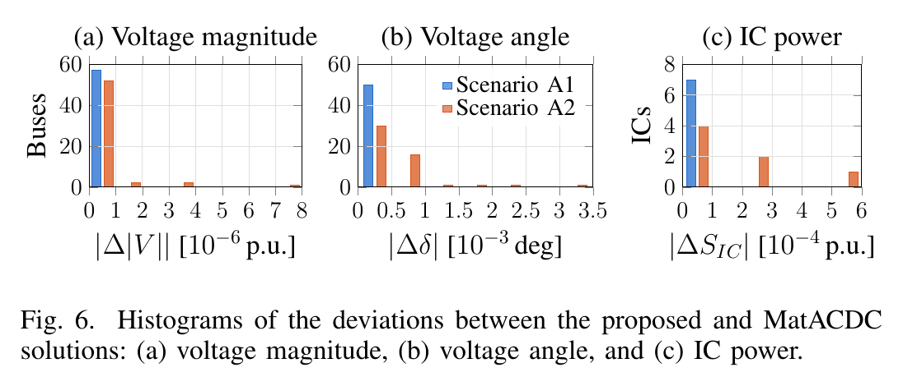
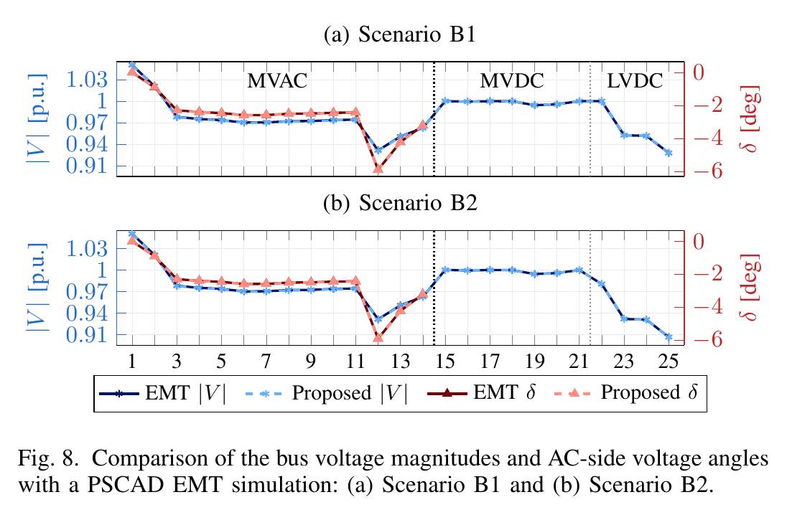
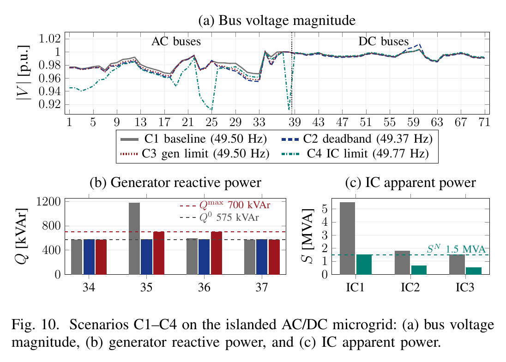
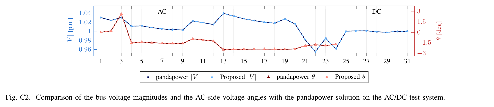

# UniGrid — AC/DC Power Flow (Python)

> AC · DC · hybrid AC/DC power flow — one compiled package, three input formats.

> Companion code for the paper *Generalized and Unified Power Flow Framework for Converter-Dominated AC/DC Power Grids* (H. Chang et al., under review).


**UniGrid** is a power flow solver for AC, DC, and hybrid AC/DC grids, compiled from
MATLAB and callable from Python. Point it at a grid file — a UniGrid Excel (`.xlsx`),
a MATPOWER m-file (`.m`), or a PSS/E raw file (`.raw`) — and it loads the grid as
editable tables and runs the power flow. The solve mode (AC/DC Hybrid, AC-only, or
DC-only) is detected automatically from the input. Works on both Windows and macOS
(the matching compiled package is selected automatically).

## How it works



## Quick start

**1. One-time setup** (finds/installs Python 3.12 and the dependencies):

- **macOS** — in a terminal, from this folder: `bash setup_mac.sh`
- **Windows** — double-click `setup_windows.bat`

**2. Open this folder** in your editor (VS Code: File → Open Folder).
On macOS it auto-uses the environment that setup created.

**3. Open `run_unigrid.py`, edit the SETTINGS block at the top, and press Run (▶).**

```python
# Pick a grid — keep ONE line without the leading "#":
GRID = "grids/rts96_scenario1_constant_vdc.xlsx"  # AC/DC Hybrid
# GRID = "grids/cigre_scenario1_constant_vdc.xlsx"    # AC/DC Hybrid
# GRID = "grids/mg71_S1_baseline.xlsx"                   # AC/DC Hybrid
# GRID = "grids/stagg5_scenario2_droop.xlsx"               # AC/DC Hybrid
# GRID = "grids/matpower_ieee14.m"                            # MATPOWER  → AC-only
# GRID = "grids/matpower_ieee118.m"                           # MATPOWER  → AC-only
# GRID = "grids/psse_ieee14.raw"                              # PSS/E     → AC-only
# GRID = "grids/psse_ieee118.raw"                             # PSS/E     → AC-only
# GRID = "grids/psse_3w_sample.raw"                           # PSS/E, 3-winding → AC-only
```

The mode is picked automatically from the file, so you only choose the grid. The
results print in the terminal (AC / DC / branch / VSC tables, whichever the mode
produces) and are saved as CSV files under `results/<grid name>/`.

**Or run one case straight from a terminal**, without editing the file. A grid
given on the command line wins over the SETTINGS block, so the case studies of
the paper can be run one after another:

```bash
python run_unigrid.py grids/rts96_scenario1_constant_vdc.xlsx
python run_unigrid.py grids/cigre_scenario2_droop.xlsx
python run_unigrid.py grids/mg71_S3_gen_qlimit.xlsx
```

**Example run** — `stagg5_scenario2_droop.xlsx` (a 5-bus AC / 3-bus DC hybrid grid):

```text
grid                : stagg5_scenario2_droop.xlsx
mode                : AC/DC Hybrid
baseMVA             : 100.0
AC buses            : 5
AC voltage min/max  : 0.9916 / 1.06 pu
DC buses            : 3
DC voltage min/max  : 0.9978 / 1.0079 pu
detailed VSC        : yes

===== AC bus result =====
 Bus   VM[pu]  Freq[pu]  Angle[deg]  Gen_P[MW]  Gen_Q[MVAR]  Load_P[MW]  Load_Q[MVAR]  toAC_P[MW]  toAC_Q[MVAR]  baseKV[kV]  Vmin[pu]  Vmax[pu]
 1.0 1.060000       1.0    0.000000 133.646211    84.320296         0.0           0.0    0.000000         0.000       345.0       0.9       1.1
 2.0 1.000000       1.0   -2.383696  40.000000   -34.828749        20.0          10.0  -59.994973       -40.000       345.0       0.9       1.1
 3.0 1.000000       1.0   -3.894980   0.000000     0.000000        45.0          15.0   20.754183        -0.854       345.0       0.9       1.1
 4.0 0.998420       1.0   -4.305740   0.000000     0.000000        40.0           5.0    0.000000         0.000       345.0       0.9       1.1
 5.0 0.991565       1.0   -4.163943   0.000000     0.000000        60.0          10.0   34.995017         5.000       345.0       0.9       1.1

===== DC bus result =====
 Bus   VM[pu]  VM_norm[pu]  Gen_P[MW]  Load_P[MW]  toDC_P[MW]  baseKV[kV]  Vmin[pu]  Vmax[pu]
 6.0 1.007913     0.079131        0.0         0.0   58.622356       345.0       0.9       1.1
 7.0 1.000003     0.000034        0.0         0.0  -21.902085       345.0       0.9       1.1
 8.0 0.997788    -0.022119        0.0         0.0  -36.180474       345.0       0.9       1.1

(the branch and VSC tables print as well, and every table is saved to results/*.csv)
```

## Input formats & modes

UniGrid picks the solver mode automatically from whatever file `GRID` points to:

| Input file | Contains | Mode |
|------------|----------|------|
| UniGrid Excel `.xlsx` | AC, DC, and interlinking-converter tables | **Hybrid, AC-only, or DC-only** — as set by the file's `Mode` sheet |
| MATPOWER `.m` | AC network only | **AC-only** |
| PSS/E `.raw` | AC network only | **AC-only** |

`.m` and `.raw` are converted to UniGrid tables in Python at load time
(see `unigrid_convert.py`); no separate Excel-conversion step is needed.

## Requirements

- **MATLAB Runtime R2024b** for your OS (free). If full MATLAB R2024b is installed,
  it is already included. Otherwise download it from
  https://www.mathworks.com/products/compiler/matlab-runtime.html
- **Python 3.9 – 3.12** (3.13+ is not supported). The setup script handles this for you.

Known issues:

- With an Anaconda Python, Windows may show a MATLAB "Access violation" report
  when the script exits. It happens after all results are written, while Python
  shuts down alongside the MATLAB Runtime, and does not affect the results. A
  python.org Python avoids it.
- On Windows, the engine's progress messages are in Korean and may appear as
  broken characters in the console. The results are not affected.

## Changing the grid and settings

Everything you normally change lives in the **SETTINGS block** at the top of
`run_unigrid.py` — edit it and press Run (▶):

- **Different grid** → switch the `GRID` line, or point it to your own UniGrid
  `.xlsx` (same sheet layout as the files in `grids/`), a MATPOWER `.m`, or a
  PSS/E `.raw`.

For finer changes (individual buses, generators, lines), either **edit the grid file
directly** (that file *is* the input), or add a line after the case is loaded, e.g.
`case.AC_gen_dat.iloc[0, 5] *= 1.2`. Editable tables include `AC_PLoad_dat`,
`AC_gen_dat`, `AC_Line_dat`, `IC_dat`, `DC_PLoad_dat`, and more.

To run **many scenarios at once**, see `run_unigrid_scenarios.py` — a template that
loops over parameter values; adapt it to your own study.

## Example inputs (`grids/`)

### Case files behind the paper's results

These are the exact inputs used for the case studies, one file per scenario
(**ICs** = interlinking converters, the stations that link the AC and DC sides).
Running one reproduces the corresponding figure in the paper.

| Grid file | System | AC / DC buses | ICs | Scenario |
|-----------|--------|---------------|-----|----------|
| `rts96_scenario1_constant_vdc.xlsx` | Modified IEEE RTS-96, transmission | 50 / 7 | 7 | Constant DC voltage |
| `rts96_scenario2_droop.xlsx` | Modified IEEE RTS-96, transmission | 50 / 7 | 7 | DC voltage droop |
| `cigre_scenario1_constant_vdc.xlsx` | Modified CIGRE benchmark, distribution | 14 / 11 | 3 | DC/DC in constant-voltage mode |
| `cigre_scenario2_droop.xlsx` | Modified CIGRE benchmark, distribution | 14 / 11 | 3 | DC/DC in droop mode |
| `mg71_S1_baseline.xlsx` | 71-bus islanded microgrid | 38 / 33 | 3 | Baseline |
| `mg71_S2_deadband.xlsx` | 71-bus islanded microgrid | 38 / 33 | 3 | Generator droop deadband |
| `mg71_S3_gen_qlimit.xlsx` | 71-bus islanded microgrid | 38 / 33 | 3 | Generator reactive-power limit |
| `mg71_S4_ic_limit.xlsx` | 71-bus islanded microgrid | 38 / 33 | 3 | IC output limit |
| `pandapower_3w.xlsx` | AC/DC system modified from pandapower's multi-voltage example | 24 / 7 | 3 | Three-winding transformer validation |
| `case2869_mtdc_droop.xlsx` | 2869-bus PEGASE with two MTDC grids | 2869 / 7 | 7 | All ICs in P--Vdc droop (Appendix) |

The four microgrid files describe the same network; each turns on one control
element so its effect can be read against the baseline. The last two files
belong to the Appendix: `pandapower_3w.xlsx` validates the
three-winding transformer model, and `case2869_mtdc_droop.xlsx` is the large
transmission system used to evaluate scalability.

The engine ships with the convergence tolerance used for the paper
(1e-6 for the hybrid and AC-only solvers). Running a case as it comes
reproduces the deviations reported in the paper; no settings need to be
changed.

### Other example inputs

A 5-bus AC / 3-bus DC hybrid system, not part of the case studies:

| Grid file | Category | AC / DC buses | ICs | DC control |
|-----------|----------|---------------|-----|------------|
| `stagg5_scenario1_constant_vdc.xlsx` | Transmission | 5 / 3 | 3 | Constant DC voltage |
| `stagg5_scenario2_droop.xlsx` | Transmission | 5 / 3 | 3 | DC voltage droop |

Plus five AC-only inputs that show the other supported formats:


| Input file | Format | System | Mode |
|------------|--------|--------|------|
| `matpower_ieee14.m` | MATPOWER | IEEE 14-bus | AC-only |
| `matpower_ieee118.m` | MATPOWER | IEEE 118-bus | AC-only |
| `psse_ieee14.raw` | PSS/E | IEEE 14-bus | AC-only |
| `psse_ieee118.raw` | PSS/E | IEEE 118-bus | AC-only |
| `psse_3w_sample.raw` | PSS/E | 40-bus, three-winding transformer | AC-only |

The IEEE 14 and IEEE 118 systems are provided in **both** MATPOWER and PSS/E form, so
you can confirm the two importers agree on the same network. They agree bus for bus
on both systems.

> **Generator reactive-power limits are always enforced.** When a generator's `Qmax` /
> `Qmin` is present in the input, UniGrid holds the generator at its limit and lets the
> bus voltage leave its setpoint, resolved inside the same Newton–Raphson iteration.
> MATPOWER's `runpf` leaves this off by default, so compare against
> `mpoption('pf.enforce_q_lims', 1)`. Against that reference the two solutions agree to
> within 5 × 10⁻⁵ p.u. on both IEEE 14 and IEEE 118; against MATPOWER's default they
> differ wherever a limit binds (IEEE 118 does, IEEE 14 does not).

Sources for these examples are listed under [Acknowledgements](#acknowledgements).

## Reproducing the paper's figures

`reproduce/reproduce.py` solves the case studies with the shipped engine and
rebuilds the quantities plotted in the validation figures.

```bash
python reproduce/reproduce.py
```

It prints one row per scenario and quantity, with two checks.

| Column | Meaning |
|--------|---------|
| `reference` | Deviation from the external solution the paper compares against (PSCAD for the CIGRE system, pandapower for the three-winding system). This is the number quoted in the paper. |
| `reported` | The deviation the paper reports, and whether the computed one stays within it. |
| `regression` | Deviation from the solution stored under `reproduce/reference/` with the current release. A non-zero value means this machine solves the case differently. |

The computed series are written to `reproduce/output/`, and the stored solutions
live in `reproduce/reference/`.

The MatACDC comparison of Fig. 6 is not rebuilt. MatACDC is a third-party MATLAB
package that this repository does not ship, so only the regression check runs
for that figure.

### The figures these numbers belong to

The validation figures of the paper and of its Appendix, typeset
from the same source that produced the article.

**Fig. 6 — modified IEEE RTS-96.** Deviation from MatACDC over every AC and DC
bus, in both IC control scenarios.



**Fig. 8 — modified CIGRE benchmark.** The EMT reference and this solution
across the three voltage levels, in both DC/DC control scenarios.



**Fig. 10 — 71-bus islanded microgrid.** The baseline and the three scenarios
that each add one outer-loop element.



**Fig. C2 — AC/DC three-winding transformer system (Appendix).** The pandapower reference
and this solution.



Adding `--plot` draws the rebuilt series as well, into `reproduce/figures/`.
That needs matplotlib, which the one-time setup does not install
(`pip install matplotlib`).

```bash
python reproduce/reproduce.py --plot
```

> © 2026 IEEE. Personal use of this material is permitted. Permission from IEEE
> must be obtained for all other uses, in any current or future media, including
> reprinting/republishing this material for advertising or promotional purposes,
> creating new collective works, for resale or redistribution to servers or
> lists, or reuse of any copyrighted component of this work in other works.
>
> The figures above are taken from the accepted version of the companion paper,
> not from the version of record. The DOI is added here once the article appears
> on IEEE Xplore.

## Files

| File | Role |
|------|------|
| **`run_unigrid.py`** | ▶ Edit the SETTINGS block and run this, or pass a grid file as an argument |
| `run_unigrid_scenarios.py` | Loop / scenario example (a template to adapt) |
| `setup_mac.sh` / `setup_windows.bat` | One-time setup (Python + deps) |
| `run_mac.sh` / `run_windows.bat` | Run from the terminal (alternative to ▶) |
| `load_case.py` | Engine: load a grid (`.xlsx` / `.m` / `.raw`) into editable tables |
| `unigrid_convert.py` | Convert a MATPOWER `.m` / PSS/E `.raw` into UniGrid tables |
| `acdc_engine.py` | Engine: run the power flow (auto-selects the OS package) |
| `_mac_worker.py` | Internal helper used on macOS only |
| `grids/` | Example inputs (Excel, MATPOWER, PSS/E) |
| `CHANGELOG.md` | What changed in each release |
| `reproduce/` | Rebuild the quantities plotted in the paper's validation figures |
| `unigrid_pkg_win/` | Compiled solver for Windows (all modes) |
| `unigrid_pkg_mac/` | Compiled solver for macOS (all modes) |
| `docs/` | README figures, and the paper's validation figures under `docs/paper/` |

<details><summary>Manual setup (without the scripts)</summary>

macOS (mwpython needs a real Python 3.9–3.12 venv):
```bash
python3.12 -m venv .venv
.venv/bin/python -m pip install pandas openpyxl
.venv/bin/python run_unigrid.py
```
Windows:
```bat
py -m pip install .\unigrid_pkg_win\for_testing
py -m pip install pandas openpyxl
py run_unigrid.py
```
</details>

## Project status & roadmap

UniGrid is **actively maintained** by its author (Hamin Chang). The companion research
paper, *Generalized and Unified Power Flow Framework for Converter-Dominated AC/DC Power Grids*, is under review. A link to the published paper will be added here.

Planned work:

- **Citation metadata** — add a `CITATION.cff` once the companion paper is published.
- **More example systems** — additional AC-only and DC-only example inputs.
- **Importer coverage** — broaden the MATPOWER (`.m`) and PSS/E (`.raw`) parsers
  (more record types, larger cases).
- **Packaging cleanup** — slim the distributed package and streamline setup.

Questions, bug reports, and suggestions are welcome via
[GitHub Issues](https://github.com/grid-modernization-lab-kor/unigrid-acdc-powerflow/issues).

## Citing UniGrid

If UniGrid is used in published work, cite the companion paper:

> H. Chang, F. Teng, G.-S. Lee, and J.-W. Chang, "Generalized and Unified Power
> Flow Framework for Converter-Dominated AC/DC Power Grids," submitted to *IEEE
> Transactions on Power Systems* (under review).

This repository is not static, so name the release the results came from, for
example `v1.0.1-paper`. Each release is tagged, and [CHANGELOG.md](CHANGELOG.md)
records what changed between them.

## License

The UniGrid source code and scripts in this repository are released under the
**MIT License** (see [LICENSE](LICENSE)) — free to use, modify, and redistribute,
including commercially, as long as the copyright notice is retained. The compiled
solver is distributed as a binary package; its MATLAB source is not included.

The bundled example inputs and the compiled MATLAB Runtime components are provided
under their own terms; see [Acknowledgements](#acknowledgements) below.

## Acknowledgements

The bundled example inputs come from established, openly documented test systems:

- **`matpower_ieee14.m`, `matpower_ieee118.m`** — IEEE 14-bus and 118-bus test cases,
  distributed with [MATPOWER](https://matpower.org) (BSD-3-Clause) as `case14` /
  `case118`, converted from the University of Washington power-system test-case archive.
- **`psse_ieee14.raw`, `psse_ieee118.raw`** — IEEE 14-bus and 118-bus test systems
  (public IEEE test-case data), expressed in PSS/E raw format.
- **`psse_3w_sample.raw`** — adapted from a Siemens **PSS®E** sample case (PSS®E-33),
  included here only to demonstrate three-winding transformer import. PSS®E is a
  registered trademark of Siemens.
